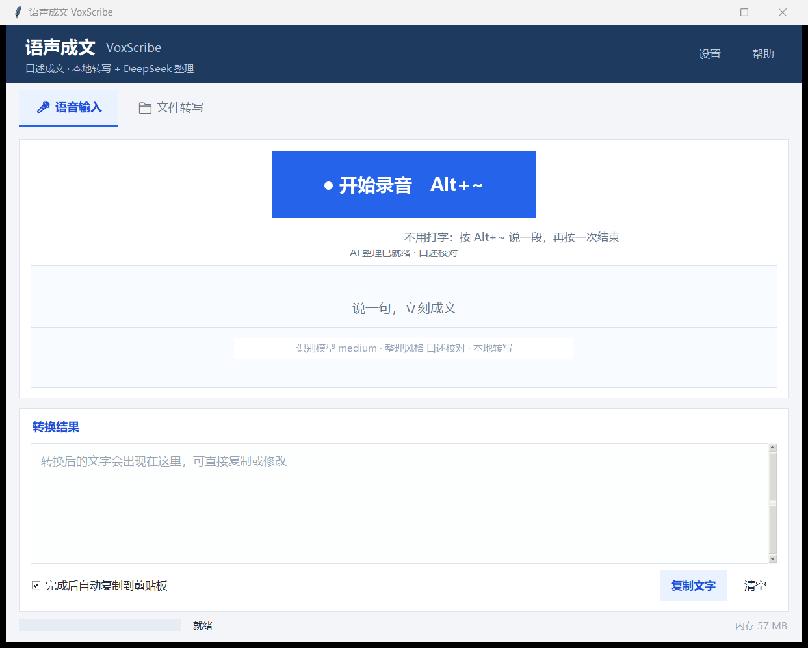
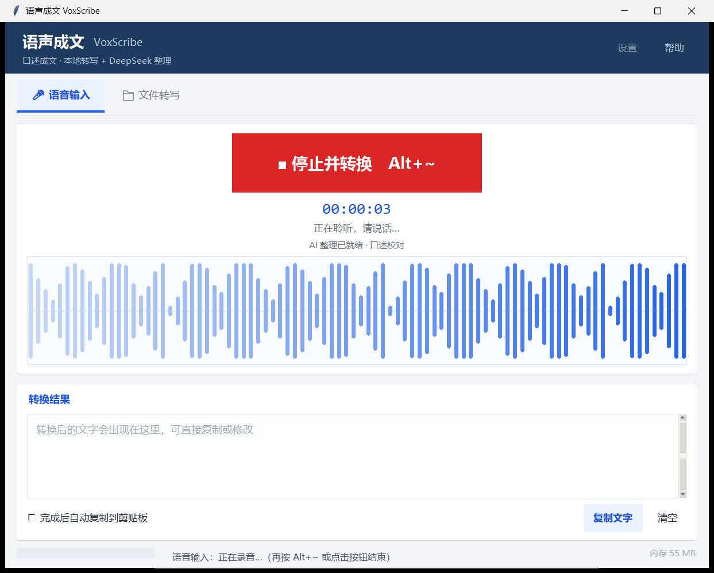
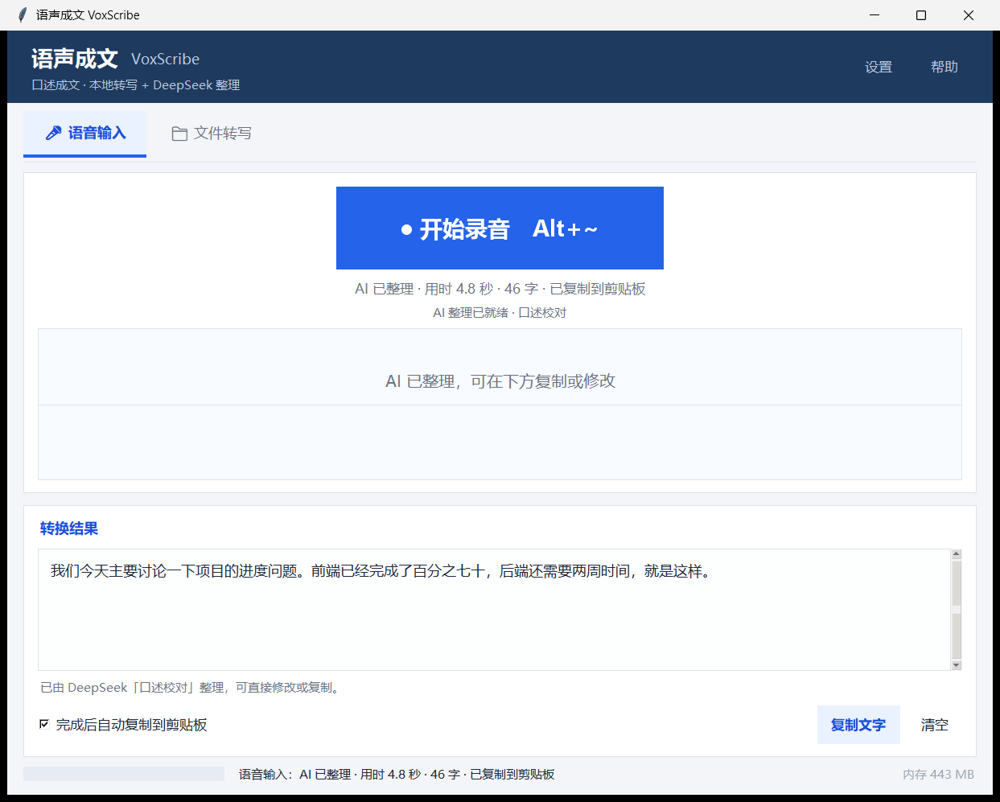
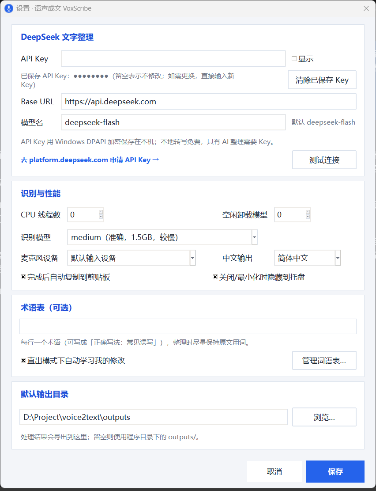
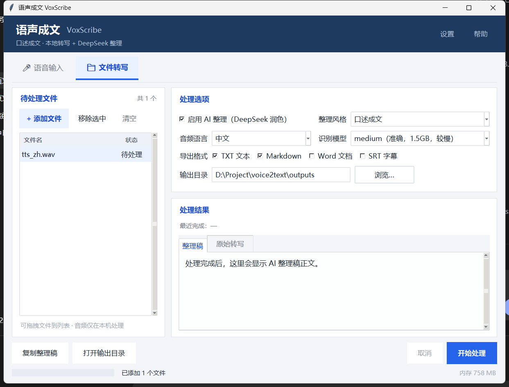

# 语声成文 VoxScribe

> 说出来，就是文字。在任何程序前面按 **Alt+~** 说一段话，再按一次，1~2 秒后得到整理好的、可直接粘贴的书面文字。
> Windows 桌面小工具 · GPU 本地转写 · DeepSeek 校对 · 托盘常驻 · 无黑框启动。
>
> GitHub 仓库：<https://github.com/Archwindos/voice2text>

## 怎么用（3 步）

> **还没安装？** 下载仓库后双击 `setup.bat`，安装完成后桌面会自动生成「语声成文 VoxScribe」快捷方式。
> **第一次用**：点右上角「设置」填 DeepSeek API Key（不填也能用，只是只做本地转写、不整理文字）。

### ① 双击快捷方式，打开软件

<p align="center">
  
</p>

首页顶部先选输出模式：**直出**（原话+简单纠错）、**对人**（正式聊天消息）、**对AI**（给 AI 的提示词）。

### ② 按 Alt+~ 说一段，说完再按一次

在任意程序里按 **Alt+~**，软件窗口会自动弹出并开始录音；对着麦克风正常说话，再按一次 **Alt+~** 结束。
也可以直接点窗口里的 **「● 开始录音」**。

<p align="center">
  
</p>

### ③ 1~2 秒出字，直接 Ctrl+V 粘贴

停止录音后，约 1 秒先显示原始文字，再用 DeepSeek 整理成最终稿；**默认已自动复制**，直接去目标软件 `Ctrl+V` 即可。
不满意可以顺手修改，再点「复制文字」或按 `Ctrl+Enter`。

<p align="center">
  
</p>

### 首次使用：填一下 DeepSeek API Key

右上角 **设置** → 粘贴 Key → **测试连接** → 保存。没有 Key 时会自动降级为「只本地转写」，完全免费、离线。

<p align="center">
  
</p>

> 长音频（会议、访谈、课程）请切到第二页 **「文件转写」**，支持批量转写和导出 txt / Word / Markdown / SRT。

---

## 一、它解决什么问题？

**不想打字的时候，直接说。** 口述笔记、聊天回复、会议发言、灵感记录……
按一下 **Alt+~**，说一段，再按一下，软件自动完成：

```
Alt+~ 开始说话 → GPU 本地转写（0.5~1 秒）→ 立即显示原始文字
                                    ↓
                       DeepSeek「口述校对」润色（去口头禅、改错别字、补标点）
                                    ↓
                        最终稿自动复制到剪贴板，直接 Ctrl+V
```

同时保留「文件转写」页：会议录音、访谈、课堂、视频等长音频可批量转写并导出文档。

## 二、关于「DeepSeek 的语音模型」

DeepSeek 官方 API 提供文本模型（当前为 `deepseek-flash`（V4.1 Flash）、`deepseek-v4-pro`），
没有公开的语音识别（ASR）接口；DeepSeek App 里的语音输入使用的是第三方技术，不对外开放。

所以本项目这样分工，各取所长：

| 环节 | 用什么 | 为什么 |
| --- | --- | --- |
| 语音 → 文字 | **本地 faster-whisper，跑在 N 卡 GPU 上**（CUDA float16） | 免费、离线、隐私；GPU 上比 CPU 快约 4~9 倍 |
| 文字 → 书面语 | **DeepSeek API（deepseek-flash，按模式选择思考强度）** | 中文表达质量高、能纠错别字、响应快、价格低 |

> DeepSeek 整理使用 **`deepseek-flash`（V4.1 Flash）**，并按语音输入模式自动选择思考强度字段 `reasoning_effort`：**直出 = `none`（不思考）**、**对人 = `low`（轻思考）**、**对AI = `high`（深度思考）**；文件转写默认 `none`，保证速度。
> 换成旧模型（如 `deepseek-chat`）时会自动不发送思考强度参数，避免 400 错误。
> 如果以后想接入云端语音识别，`voxscribe/asr.py` 是独立模块，替换掉即可。

## 三、功能特性

### 🎤 首页「语音输入」——主打功能

- **全局快捷键 Alt+~**：在 Word、微信、浏览器等任何程序前面按 **Alt+~**：**软件窗口会自动弹到前台并开始录音**；再按一次结束。软件在托盘待机时也生效。
- **实时语音波形**：说话时波形随音量跳动，确认麦克风真的在收音；红色按钮 + 计时。波形保留顶部余量，正常说话不会顶到上沿。
- **极速出字**：GPU 转写完成后**先把原始文字显示出来**（状态显示「已转写，正在 DeepSeek 润色…」），DeepSeek 整理完再用最终稿替换——不用盯着空白等全程。
- **自动语言检测**：默认自动识别中/英文——说英文就输出英文，**不会被翻译成中文**；中英混说时英文单词保持原样。
- **三种输出模式**（录音前在首页切换，选择会被记住）：
  - **直出**：只做最低限度的错别字/同音字纠错，保留你的原话、语序和语气（`reasoning_effort=none`，最快）；
  - **对人**：整理成一条可以直接发给同事/客户的正式聊天消息，礼貌自然、不写成邮件（`reasoning_effort=low`）；
  - **对AI**：整理成结构清晰、可直接发给 AI 的提示词/命令，保留约束与输出要求（`reasoning_effort=high`）。
- **简繁统一**：中文输出默认统一为简体（设置 → 识别与性能 →「中文输出」可切换繁体/保持原文）。ASR 原文和 DeepSeek 最终稿都会做一次确定性转换，不再出现「同一段话有时繁体、有时简体」。
- **词语自动学习**（直出模式）：在结果框里把「阴轨」改成「音轨」后，系统自动提取词对并学习；同一错误第 2 次出现自动生效，可在 设置 → 术语表 →「管理词语表…」查看/启停/删除。
- **单实例运行**：同一时间只允许一个 VoxScribe 窗口；重复双击/重复启动不会双开，只会把已打开的主窗口（包括隐藏在托盘的窗口）拉到前台。
- **自动复制**：设置里可开启「完成后自动复制到剪贴板」（默认开），最终稿直接到剪贴板。
- **识别模型统一设置**：设置 → 识别与性能 →「识别模型」，语音输入和文件转写共用这一个设置，不会出现两个页面对不上的情况。
- **麦克风可选 + 无声提醒**：设置里可以选择具体麦克风（默认系统设备）；录音 1.5 秒仍没有检测到声音会直接提示「请检查麦克风是否静音/选错设备」，不会让你对着空气说话还不知道。
- **麦克风采样率自适应**：16kHz 不支持的设备（不少 USB/蓝牙麦克风）会自动改用设备默认采样率（44.1/48kHz），接上就能用。
- **结果可编辑**：转换后可以顺手改两个词，再点「复制文字」或按 `Ctrl+Enter`。
- **没有 Key 也能用**：自动降级为只做本地转写，完全免费、离线。
- **启动预热**：程序启动后在后台把识别模型加载到 GPU（状态栏提示），第一句口述也不用等。
- **快捷键**：`Alt+~` 开始/结束，`Esc` 取消录音或转换，`Ctrl+Enter` 复制结果。

### 🖥️ 无黑框 + 托盘常驻

- 双击桌面 **「语声成文 VoxScribe」快捷方式**启动：只显示软件窗口，**不出现黑色命令行窗口**；快捷方式指向项目自带的 `VoxScribe.exe` 无黑框启动器（Windows GUI 子系统，即使系统默认终端是 Windows Terminal 也不会弹控制台）；桌面图标由 `setup.bat` 自动创建，误删后可运行 `tools\create_shortcut.ps1` 重建；
- 关闭窗口 / 最小化 → **隐藏到桌面右下角系统托盘待机**（首次会气泡提示）；
- 托盘图标右键菜单：显示主界面、开始/停止录音（Alt+~）、退出；
- 双击托盘图标恢复主界面；退出请用托盘菜单「退出」。

### 📁 第二页「文件转写」

- 批量添加 / 拖拽音频（mp3、wav、m4a、aac、flac、ogg、opus、mp4、mov、mkv 等）；
- **5 种整理风格**：
  - **口述校对**：去口头禅、纠同音错别字、补标点（语音输入默认）
  - **口述成文**：口语转成通顺书面语，按语义分段
  - **会议纪要**：结构化输出议题、结论、待办事项
  - **逐字稿润色**：保留原话，只做最小清洗
  - **要点摘要**：压缩成要点列表
- **术语表**：人名、公司名、专业词按指定写法校正同音错字；手动维护 + 从直出模式的修改中自动学习；
- 导出 txt / Markdown / Word（docx）/ SRT 字幕，附一份带时间戳的原始转写；
- 批量队列、进度、取消、失败跳过；重名自动加 `(2)` 不覆盖。

### ⚡ GPU 加速（实测数据，RTX 5060 Laptop 8GB + 驱动 610.88）

| 识别模型 | 加载到 GPU | 13 秒音频转写 | GPU 显存增量 |
| --- | --- | --- | --- |
| tiny | ~1.2s | 0.66s | +0.2GB |
| small | ~1.0s | 0.45s | +0.6GB |
| **medium（默认）** | ~1.9s | **0.72s** | **+1.9GB** |
| CPU 对照：medium | ~4.4s | 6.41s | — |

- 口述完成后：GPU 转写 ~0.7s + DeepSeek 润色 ~1s + 显示，**整体约 2 秒左右**；
- 模型加载后常驻显存（`idle_unload_minutes` 默认 0），后续口述不再重复加载；
- 程序启动时后台预热，第一次口述也快；第一次冷启动（重启电脑后）首次加载会多花几秒，只发生一次。

### 🪶 轻量、隐私

- 无 Electron / 无浏览器内核 / 无 PyTorch / 无 ffmpeg 可执行文件；
- GPU 模式只占用约 2GB 显存（medium）；CPU 模式默认最多 4 线程；
- 语音识别全程在本机 GPU 完成，**音频不上传**；只有 AI 整理时上传**文字**；
- API Key 用 Windows DPAPI 加密保存在本机，日志不记录 Key；
- 断网仍可使用「只转写」；模型只需下载一次。

## 四、快速开始

### 1. 启动

双击桌面上的 **「语声成文 VoxScribe」快捷方式**（安装时自动创建，带图标；也可以双击 `run.vbs`）。启动后软件会出现在桌面右下角托盘 + 主窗口，没有黑色命令行窗口。

> 换电脑/重装：先双击 `setup.bat` 安装依赖（约 1.3GB，含 CUDA 运行库）并下载识别模型（默认 medium 约 1.5GB），之后再双击 `run.vbs`。

### 2. 配置 DeepSeek API Key（AI 整理需要）

1. 打开 [platform.deepseek.com](https://platform.deepseek.com/) → **API Keys** → 创建 Key（`sk-` 开头，只显示一次）；
2. 软件右上角 **设置** → 粘贴 API Key → **测试连接** → 保存。
   （本机已经配置好，可跳过；想更换再操作。）

> 不配置 Key 也能用：软件会自动改为只做本地转写，完全免费、离线。

### 3. 选择输出模式并开始说

1. 首页顶部「模式」里选 **直出 / 对人 / 对AI**（默认直出，选择会记住）；
2. 在任意程序里按 **Alt+~**（或点软件里的大按钮）；
3. 对着麦克风说话，波形会实时跳动；
4. 再按一次 **Alt+~** 结束录音；
5. **约 1 秒**先看到原始文字（状态提示「正在 DeepSeek 润色…」），再等约 0.5~2 秒变成整理好的最终稿（对人/对AI 模式会多花一点思考时间）；
6. 最终稿默认已自动复制，直接 `Ctrl+V`；也可以修改后再点「复制文字」。

## 五、使用技巧与快捷键

| 操作 | 快捷键 / 位置 |
| --- | --- |
| 开始 / 结束录音（全局，自动弹窗） | **`Alt+~`** |
| 取消录音 / 中止转换 | `Esc` |
| 复制转换结果 | `Ctrl+Enter`（或「复制文字」按钮） |
| 切换输出模式 | 首页顶部「模式」：直出 / 对人 / 对AI |
| 中文简繁输出 | 设置 → 识别与性能 →「中文输出」：简体 / 繁体 / 保持原文 |
| 查看/管理学习词语 | 设置 → 术语表 →「管理词语表…」 |
| 自动复制开关 | 设置 → 识别与性能 →「完成后自动复制到剪贴板」 |
| 中英混说 / 说英文 | 默认自动识别，不会翻译成中文；如异常请确认未把语言固定为中文 |
| 从托盘恢复主界面 | 双击托盘图标，或右键 → 显示主界面 |
| 退出软件 | 右键托盘图标 → 退出 |
| 长音频、会议录音 | 顶部切到「文件转写」页 |
| 只转写不整理 | 设置里清空 Key，或文件页取消勾选「启用 AI 整理」 |

- **Alt+~ 是全局快捷键**：软件在托盘待机时也能用；如果某些程序也占用了这个组合，可以在托盘菜单里点按钮操作。
- 结果框是**可编辑**的：转换后可以顺手改两个词再复制；
- 音频文件保存在 `data/recordings/`，忘记复制时还能回去找；
- 术语表（设置里）适合固定人名、公司名、专业词汇，能显著减少同音错字。

## 六、界面说明

**首页「语音输入」**（下图）：大录音按钮、实时波形、两段式结果区。

<p align="center">
  
</p>

<p align="center">
  
</p>

**文件转写页**：左侧文件队列，右侧处理选项与结果预览。

<p align="center">
  
</p>

**设置**：API Key、麦克风设备、性能、中文输出字形、术语表/词语学习、输出目录。

<p align="center">
  
</p>

- 顶部导航切换「语音输入 / 文件转写」；右上角「设置」「帮助」；
- 底部状态栏：进度、当前状态（内存等诊断信息已收起，保持界面干净）；
- 设置：API Key、Base URL / 模型名、术语表与词语自动学习、CPU 线程数、空闲卸载、中文输出（简体/繁体/保持原文）、默认输出目录、麦克风设备、测试连接、关闭到托盘。

## 七、模型怎么选？

| 模型 | 下载大小 | GPU 显存增量 | 中文准确率 | 速度（GPU） | 建议 |
| --- | --- | --- | --- | --- | --- |
| `tiny` | ~75MB | ~0.2GB | 一般 | 最快 | 老电脑、只求有个稿子 |
| `base` | ~145MB | ~0.3GB | 够用 | 快 | 轻量优先 |
| `small` | ~484MB | ~0.6GB | 好 | 很快 | 显存紧张或追求极致响应 |
| **`medium`** | ~1.5GB | ~1.9GB | **很好** | **快（0.7s/13s 音频）** | **默认推荐** |
| `large-v3` | ~3.1GB | ~3GB | 最好 | 中等 | 8GB 显卡可尝试，一般不必 |

> 在「设置 → 识别与性能 → 识别模型」里切换（语音输入与文件转写共用）；本机已缓存 tiny / small / medium（共约 2GB，无需再下载）。
> 模型缓存在 `data/models/`，删除即清理。

## 八、导出格式（文件转写页）

| 格式 | 内容 |
| --- | --- |
| `.txt` | 整理后的正文，纯文本 |
| `.md` | 带标题与元信息的 Markdown |
| `.docx` | Word 文档（标题 + 元信息 + 正文，可直接编辑） |
| `.srt` | 由原始转写时间戳生成的字幕 |
| `_原始转写.txt` | 有整理稿时额外保存的逐段原文（带时间戳），便于核对 |

文件名冲突时自动加 `(2)`、`(3)`，不会覆盖旧文件。

## 九、命令行用法（进阶 / 批量自动化）

```powershell
# 自检环境
.venv\Scripts\python.exe -m voxscribe --check

# 处理音频文件（默认开启 AI 整理）
.venv\Scripts\python.exe -m voxscribe -i D:\录音\会议.mp3 --style meeting

# 批量 + 指定输出格式与目录
.venv\Scripts\python.exe -m voxscribe -i D:\录音\*.m4a -o D:\整理稿 --formats txt,md,docx

# 只转写不整理（完全离线，不需要 API Key）
.venv\Scripts\python.exe -m voxscribe -i 访谈.wav --no-refine --print
```

参数：`-i/--input` 文件或通配符、`-o/--out` 输出目录、`--style` 风格、`--language` 语言、
`--model` 识别模型、`--formats` 导出格式、`--no-refine` 只转写、`--print` 终端打印正文、`--check` 自检。

## 十、配置项（`data/config.json`）

| 键 | 说明 | 默认 |
| --- | --- | --- |
| `asr_model` | 识别模型 | `medium` |
| `asr_device` | 识别设备：`cuda`（GPU）/ `cpu`（备用） | `cuda` |
| `compute_type` | 计算精度，`auto`=GPU float16 / CPU int8 | `auto` |
| `cpu_threads` | CPU 模式线程数，`0`=自动（最多 4） | `0` |
| `language` | 音频语言 | `zh` |
| `vad_filter` | 过滤静音段（更快更准） | `true` |
| `model_dir` | 模型缓存目录，空=`data/models` | 空 |
| `input_device` | 麦克风设备名；空=系统默认输入设备 | 空 |
| `idle_unload_minutes` | 空闲多少分钟后卸载模型；`0`=常驻不卸载（推荐，口述更快） | `0` |
| `preload_model` | 启动时后台预热识别模型 | `true` |
| `close_to_tray` | 关闭/最小化时隐藏到托盘待机 | `true` |
| `api_base_url` | DeepSeek 接口地址（可填兼容代理） | `https://api.deepseek.com` |
| `api_model` | 文本整理模型 | `deepseek-flash` |
| `api_reasoning_effort` | 默认思考强度（`none`/`low`/`high`…；语音模式会覆盖） | `none` |
| `quick_mode` | 语音输入模式：`direct`（直出）/ `person`（对人）/ `ai`（对AI） | `direct` |
| `api_key_enc` | 加密后的 API Key（勿手工修改） | 空 |
| `refine_by_default` | 文件页默认开启 AI 整理 | `true` |
| `default_style` | 文件页默认整理风格 | `oral` |
| `export_formats` | 默认导出格式 | `["txt","md"]` |
| `glossary` | 手动术语表（「正确写法：常见误写」） | 空 |
| `chinese_script` | 中文输出字形：`simplified` / `traditional` / `preserve` | `simplified` |
| `auto_glossary_learn` | 直出模式下自动学习词语 | `true` |
| `output_dir` | 输出目录，空=`outputs/` | 空 |
| `auto_copy` | 语音输入完成后自动复制 | `true` |

## 十一、隐私与安全

- 语音识别在本机 GPU 完成，**音频文件不会上传**；
- 只有启用「AI 整理」时，**转写出的文字**才会发送到 DeepSeek 的 API；
- API Key 使用 Windows DPAPI 加密保存，日志中不会记录 Key；
- 断网时仍可使用「只转写」模式；模型下载需要联网（仅一次）；
- 所有数据都在本文件夹内（`data/`、`outputs/`），整个文件夹拷走即可迁移，删除即卸载。

## 十二、常见问题

**1. 按 Alt+~ 没反应？**
确认软件正在运行（托盘有图标）。Alt+~ 是全局热键，软件在托盘待机时也可用；如果某个程序抢占了该组合，可以先点托盘图标恢复主界面，再点大按钮。
如果所有方式都不行，可运行 `debug-run.bat` 看日志。

**2. 第一次转换为什么慢？**
首次使用（尤其重启电脑后第一次）需要把模型加载到 GPU，约 2~9 秒；程序启动时会自动后台预热，之后每次口述都很快（约 1~2 秒）。
如果设置了 `idle_unload_minutes>0`，空闲卸载后下一次会重新加载。

**3. 提示 GPU / CUDA 错误怎么办？**
先运行一次 `setup.bat` 补装 CUDA 运行库（`nvidia-cublas-cu12`、`nvidia-cudnn-cu12`）。
仍不行可临时用 CPU：把 `data/config.json` 里 `"asr_device"` 改成 `"cpu"`（`compute_type` 保持 `auto`），重启软件——CPU 也能用，只是慢一些。

**4. 托盘图标在哪里？**
桌面右下角通知区域（可能隐藏在向上箭头「^」里）。双击恢复主界面，右键可开始录音 / 退出。
如果 Windows 关闭了通知，首次隐藏的提示气泡不会显示，不影响功能。

**5. 为什么没有黑色命令行窗口了？**
请用桌面 **「语声成文 VoxScribe」快捷方式**启动（或项目里的 `VoxScribe.exe`）。启动器是 Windows GUI 程序，从源头就不会创建控制台窗口；即使误用 `python.exe` 等方式启动，程序也会尽量隐藏控制台。
需要看报错/调试时，用 `debug-run.bat`（会保留控制台并输出日志）。

**6. 模型下载失败 / 一直卡住？**
本机已缓存 tiny/small/medium，通常无需下载。换电脑时：
```powershell
$env:HF_ENDPOINT="https://hf-mirror.com"
.venv\Scripts\python.exe tools\prefetch_model.py --model medium
```

**7. DeepSeek 报 401 / 402 / 429？**
- 401：Key 错误或失效 → 设置里重新填写；
- 402：账户余额不足 → 到 platform.deepseek.com 充值；
- 429：请求频繁/额度限制 → 稍等再试（软件会自动退避重试）。

**8. 识别有明显的同音错字？**
- 已默认用 medium 模型；仍不满意可在文件页切 `large-v3`（8GB 显卡）；
- 在设置「术语表」里填人名、公司名、专业词；
- 「口述校对」会自动纠正常见同音错字（在/再、的/得/地、帐/账、以下/一下），拿不准的保留原文。

**9. 关闭窗口后软件好像消失了？**
它被隐藏到托盘继续待机（这是为了 Alt+~ 随时可用）。要彻底退出，请右键托盘图标 → 退出。

**10. 支持哪些音频格式？**
常见格式都支持（mp3/wav/m4a/aac/flac/ogg/opus/mp4/mov/mkv）。微信 `.silk` 需先转成 wav/mp3。

**11. 说话时波形不动 / 提示「没有检测到声音」？**
说明当前麦克风没有收到声音，常见原因：
- 系统默认麦克风选错了（比如默认是耳机麦克风，但你在用笔记本麦克风）→ 打开「设置 → 麦克风设备」换一个试试；
- 麦克风被静音：系统「设置 → 声音 → 输入」或麦克风实体静音键；
- Windows 隐私权限没开：设置 → 隐私和安全性 → 麦克风 → 允许桌面应用访问；
- 麦克风被其他软件独占（会议软件等）→ 关掉占用它的软件。
录音时波形会实时跳动，看到明显起伏就说明在正常收音。

**12. 我有多个麦克风/耳机，怎么切换？**
设置 → 麦克风设备，选好后保存，下次按 Alt+~ 就用这个设备；选「默认输入设备」则跟随系统。
（程序支持采样率自适应：16k 不支持的设备会自动用 44.1/48kHz。）

**13. 说英语时被翻译成中文了？**
v1.3.1 起默认语言为「自动检测」：英文语音会输出英文，不会被翻译；中英混说时英文单词保持原样。
如果仍出现翻译，请检查设置里的语言是否被固定为「中文」（文件转写页的「音频语言」下拉也请保持「自动检测」）。
另外 AI 整理 prompt 已加入「保持原文语言、不要翻译」的硬性要求。

**14. 桌面快捷方式丢了 / 换电脑了？**
运行 `tools\create_shortcut.ps1` 会在桌面重新创建「语声成文 VoxScribe」快捷方式；重新运行 `setup.bat` 也会自动创建。

**15. 为什么用 deepseek-flash，不用 chat？**
当前 DeepSeek 最新是 V4.1 Flash（模型 ID `deepseek-flash`）。本软件按语音模式设置 `reasoning_effort`：直出 `none`、对人 `low`、对AI `high`；文件转写默认 `none`。整理一句话通常 0.5~1 秒完成；`deepseek-chat` 是旧模型，速度和效果都不如 V4.1 Flash。
如果以后要换别的模型，在设置里改「模型名」即可；旧模型不会收到思考强度参数。

**16. 桌面快捷方式启动时报 CUDA/cublas 错误？**
v1.3.3 起桌面快捷方式使用自带的 `VoxScribe.exe` 无黑框启动器，会自动读取 venv 依赖目录；如仍报 CUDA 错误，先运行一次 `setup.bat` 补装 CUDA 运行库。

**17. 用 NVIDIA GPU 还是 Intel NPU？**
本机实测（RTX 5060 Laptop vs Intel AI Boost NPU，Whisper medium）：GPU 13 秒音频 **0.78 秒** 出结果，NPU 需要 **2.46 秒**，且首次编译模型要 6~8 分钟、内存约 4GB。**继续用 NVIDIA GPU 是最优选择**。完整测试数据见 [docs/benchmark-gpu-vs-npu.md](docs/benchmark-gpu-vs-npu.md)。

**18. 首页的「直出 / 对人 / 对AI」三种模式有什么区别？**
| 模式 | 适合场景 | 输出 | 思考强度 |
| --- | --- | --- | --- |
| **直出** | 想原样保留自己的说法，只修错别字 | 保留语序、语气和口头禅，只纠错 | `none`（最快） |
| **对人** | 微信/钉钉发同事、客户、上级 | 一条正式但不生硬的消息，去口语、补逻辑 | `low` |
| **对AI** | 把口述需求变成给 AI 的提示词 | 结构清晰的 prompt，保留目标/约束/输出要求 | `high` |
模式会记住上次选择；录音/转换过程中不能切换。文件转写页仍使用原来的 5 种整理风格，与语音输入的三种模式相互独立。

**19. 为什么以前有时输出繁体、有时简体？**
Whisper 在自动语言模式下没有简体提示、DeepSeek 的 prompt 也没有硬性简繁规则，加上模型输出有随机性，就会时好时坏。v1.6.0 起：设置里可选「中文输出」（默认简体），ASR 原文和最终稿都会用 OpenCC 做确定性转换；prompt 也加入了简繁硬性规则。排查过程见 [docs/traditional-chinese-investigation.md](docs/traditional-chinese-investigation.md)。

**20. 词语自动学习是怎么工作的？**
只在「直出」模式下生效：以本次最终稿为基线，比较你修改后的文本，用字符级对齐提取「错词 → 正确词」；标点、繁简、整段重写、单字和含数字的片段会被过滤。首次出现进入待确认，同一错误出现第 2 次自动生效；学习记录保存在 `data/glossary.json`，详细 JSONL 试验日志在 `data/logs/glossary_learn.jsonl`。设计说明见 [docs/glossary-auto-learning-design.md](docs/glossary-auto-learning-design.md)。

**21. 为什么重复打开会出现两个窗口？**
v1.6.1 起已加入单实例互斥量：第一个实例运行后，第二个实例会通过命名事件请求显示已有窗口，然后自己立即退出，不会再创建第二个窗口。若仍出现双开，请确认两个窗口来自同一版本；可在托盘退出全部实例后重新启动。

## 十三、项目结构

```
voice2text/
├─ setup.bat               一键安装（依赖 + CUDA + 模型 + 桌面快捷方式）
├─ assets/voxscribe.ico    应用/快捷方式图标
├─ VoxScribe.exe           无黑框启动器（桌面快捷方式指向它）
├─ run.vbs                 启动脚本（备用/旧入口）
├─ debug-run.bat           调试启动（保留控制台 + 日志）
├─ diagnose.bat            环境自检
├─ requirements.txt
├─ voxscribe/
│  ├─ __main__.py          入口（GUI / 命令行）
│  ├─ config.py            配置与路径（GPU/托盘/API Key 加密/简繁设置）
│  ├─ secure.py            Windows DPAPI 封装
│  ├─ models.py            数据结构契约（含 5 种整理风格）
│  ├─ errors.py            异常类型
│  ├─ asr.py               faster-whisper GPU/CPU 转写（CUDA DLL 自动加载）
│  ├─ recorder.py          麦克风录音 + 实时音量
│  ├─ refine.py            DeepSeek 整理调用（分块/重试/取消）
│  ├─ script_normalize.py  中文简繁统一（OpenCC）
│  ├─ glossary.py          词语表自动学习/本地替换/存储
│  ├─ prompts.py           整理风格 + 直出/对人/对AI 提示词
│  ├─ pipeline.py          转写→整理→导出 流水线（支持两段式回调/预热）
│  ├─ export.py            txt/md/docx/srt 导出
│  ├─ util.py              小工具
│  └─ gui/
│     ├─ app.py            主窗口（语音输入页 + 文件转写页）
│     ├─ hotkey.py         全局 Alt+~ 热键
│     ├─ tray.py           系统托盘常驻
│     ├─ dialogs.py        设置/帮助/首次引导
│     └─ theme.py          配色与样式
├─ tests/                  自动化测试（pytest，默认隐藏运行不弹窗）
├─ launcher/                无黑框启动器 C# 源码（VoxScribe.exe）
├─ tools/                  安装/下载/快捷方式/图标/启动器构建脚本
├─ data/                   配置、模型、录音、日志、glossary.json（运行时生成）
└─ outputs/                默认输出目录
```

## 十四、开发与测试

```powershell
# 安装开发依赖（pytest）
.venv\Scripts\python.exe -m pip install -r requirements-dev.txt

# 单元测试（默认跳过需要真实模型/GPU 的端到端用例）
.venv\Scripts\python.exe -m pytest -q

# 全部测试：真实 ASR + GPU + 完整流水线 + 图形界面端到端
$env:VOXSCRIBE_RUN_ASR="1"
$env:VOXSCRIBE_RUN_GPU="1"
.venv\Scripts\python.exe -m pytest -q
```

> 开发提示：GUI 测试默认通过 `VOXSCRIBE_GUI_HIDDEN=1` / `VOXSCRIBE_DISABLE_TRAY=1`
> 在隐藏窗口中运行，不会在你的桌面上弹出调试窗口或创建托盘图标。

模块职责：`asr.py`（GPU/CPU 识别）、`recorder.py`（录音与波形）、`refine.py`（DeepSeek 整理）、
`prompts.py`（风格提示词）、`export.py`（写文件）、`pipeline.py`（编排）、`gui/`（界面/托盘/热键）；
数据结构与异常定义在 `models.py` / `errors.py`。

## 十五、已知限制

- **需要 NVIDIA 显卡**才能用 GPU 转写；没有 N 卡可在配置里 `asr_device` 改 `cpu`（慢一些）；
- 麦克风采样率会自动适配（16k 不支持时用设备默认采样率），极少数仅支持特殊通道格式的设备可能需换一个麦克风；
- **没有说话人分离**：不会自动区分「谁在说」；
- 暂不支持实时字幕（边说边出字），只支持录完立刻转换；
- Alt+~ 为全局轮询热键（50ms），极少数独占键盘的程序/远程桌面场景可能失效；
- 关闭窗口默认隐藏到托盘（不退出），彻底退出请用托盘菜单；
- DeepSeek 整理按块进行，极长文本的块与块衔接处建议人工扫一眼。

## 十六、说明

- 本项目为个人效率工具，按「现状」提供；
- 使用 DeepSeek API 产生的费用由你的 DeepSeek 账户承担（短句整理通常每次几厘钱，以官网价格为准）；
- 请遵守录音相关法律法规，尊重他人隐私，录制前取得必要同意。

