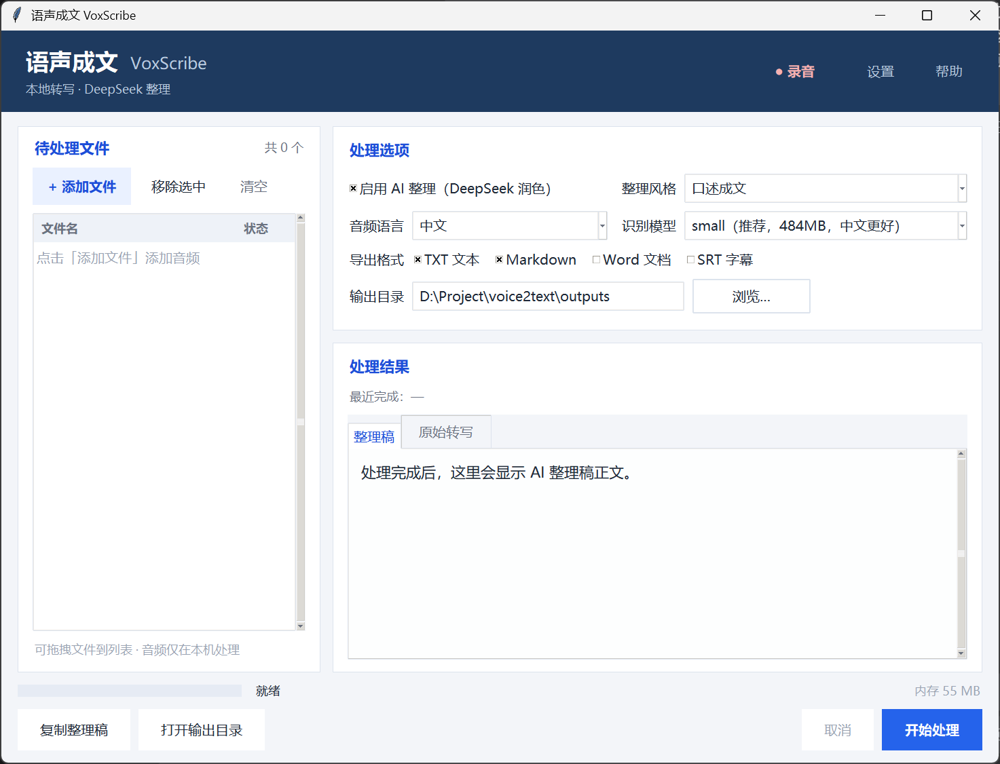
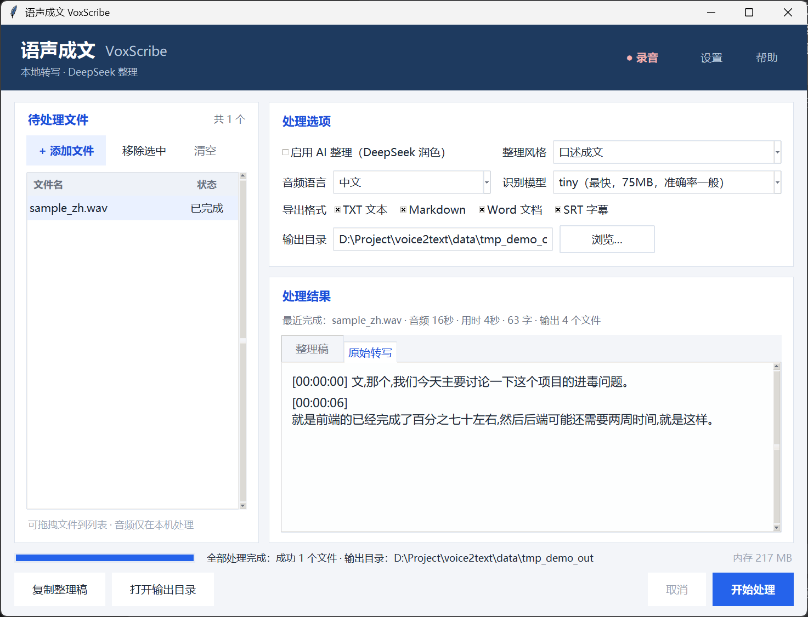
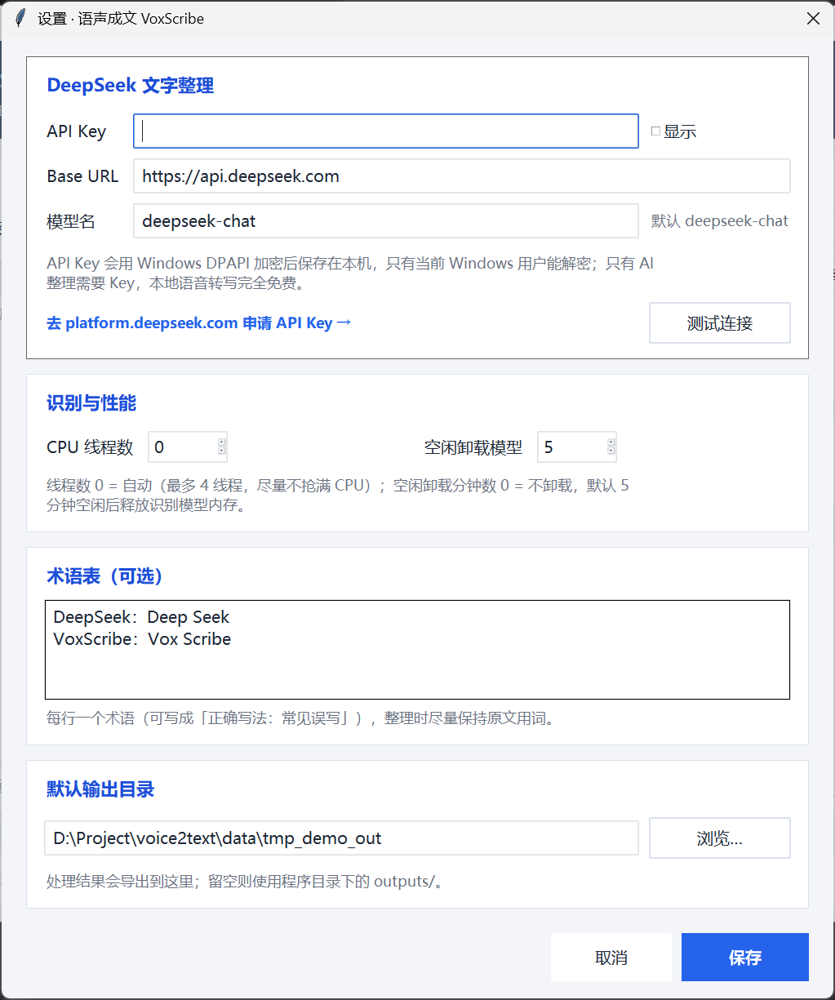

# 语声成文 VoxScribe

> 把语音内容整理成**可直接使用的书面文字**：本地转写 → DeepSeek 润色 → 导出文档。
> Windows 桌面小工具，轻量、离线可用、隐私友好。

<p align="center">
  
</p>

---

## 一、它解决什么问题？

会议录音、访谈、课堂、口述灵感……这些内容变成文字通常有两个麻烦：

1. **听写累**：1 小时录音人工整理要 3~4 小时；
2. **转写稿没法直接用**：语音识别出来的是口语——"嗯""那个""就是说"、重复、没有标点、没有段落。

语声成文把这两步串起来：

```
音频 / 麦克风录音
   │
   ▼
① 本地语音识别（faster-whisper，CPU 运行，音频不上传）
   │  带时间戳的原始转写
   ▼
② DeepSeek 整理（deepseek-chat API，只上传文字）
   │  去口头禅、补标点、分段落；或生成会议纪要 / 摘要
   ▼
③ 导出 txt / Markdown / Word / SRT 字幕
```

## 二、关于「DeepSeek 的语音模型」

DeepSeek 官方 API 目前**只提供文本模型**（`deepseek-chat`、`deepseek-reasoner`），
没有公开的语音识别（ASR）接口；DeepSeek App 里的语音输入使用的是第三方技术，不对外开放。

所以本项目这样分工，各取所长：

| 环节 | 用什么 | 为什么 |
| --- | --- | --- |
| 语音 → 文字 | **本地 faster-whisper**（OpenAI Whisper 的 CTranslate2 加速版） | 免费、离线、隐私；CPU int8 量化，轻量 |
| 文字 → 书面语 | **DeepSeek API（deepseek-chat）** | 中文书面表达质量高、价格低、响应快 |

> 如果以后想接入云端语音识别，`voxscribe/asr.py` 是独立模块，替换掉即可。

## 三、功能特性

- 🎧 **音频文件转写**：mp3 / wav / m4a / aac / flac / ogg / opus / mp4 / mov / mkv 等（由 PyAV 解码，无需另装 ffmpeg）
- 🎙️ **麦克风录音**：点一下开始录，停止后自动加入转写队列
- 🤖 **4 种整理风格**：
  - **口述成文**：口语变书面语，去"嗯/那个/就是说"、补标点、按语义分段
  - **会议纪要**：结构化输出议题、结论、待办事项
  - **逐字稿润色**：保留原话，只做最小清洗
  - **要点摘要**：压缩成 3~8 条要点
- 📚 **术语表**：人名、公司名、专业术语按你指定的写法校正同音错字
- 📦 **批量处理**：多选 / 拖拽多个文件，排队依次处理，可随时取消
- 💾 **多格式导出**：txt、Markdown、Word（docx）、SRT 字幕；默认同时保留一份带时间戳的原始转写
- 🔐 **API Key 本机加密**：Windows DPAPI 加密保存，只有当前 Windows 用户能解密
- 🪶 **轻量**：
  - 无 Electron / 无浏览器内核 / 无 PyTorch / 无 ffmpeg 可执行文件
  - CPU 默认最多 4 线程，不会把机器跑满
  - 模型空闲 5 分钟自动卸载，内存即时释放（可在设置中调整）
  - 模型按需选择：tiny 75MB / base 145MB / small 484MB / medium 1.5GB
  - **实测**（本机 20 核 CPU）：界面空载约 55MB 内存；small 模型转写峰值约 400MB；
    空闲卸载后回落到约 100MB；13 秒音频约 1.5 秒转写（4 线程，首次加载另需约 2 秒）
- 🔒 **隐私**：语音始终在本机处理；只有「整理」这一步会把**文字**发送给 DeepSeek
- 🖥️ 纯中文界面，单窗口，双击即用

## 四、快速开始

### 1. 安装（只需一次）

双击 **`setup.bat`**。它会：

1. 创建独立的 Python 3.11 虚拟环境（不污染系统 Python）；
2. 安装依赖（首次约下载 250MB，需要几分钟）；
3. 检查运行环境；
4. 询问是否现在下载中文识别模型 `small`（约 484MB，建议下载；跳过的话第一次转写时会自动下载）。

> 如果提示找不到 Python/uv：安装 [Python 3.11](https://www.python.org/downloads/) 或 `winget install astral-sh.uv` 后重跑 `setup.bat`。

### 2. 启动

双击 **`run.bat`**（无黑色控制台窗口）。

### 3. 配置 DeepSeek API Key（AI 整理需要）

1. 打开 [platform.deepseek.com](https://platform.deepseek.com/) → 注册/登录 → **API Keys** → 创建 Key（`sk-` 开头，只显示一次，请复制）；
2. 在软件里点右上角 **设置** → 粘贴 API Key → 点 **测试连接** 确认可用 → 保存。

> 不配置 Key 也能用：关闭「AI 整理」后只做本地转写，完全免费、离线。
> API Key 会经 Windows DPAPI 加密后保存在本机 `data/config.json`。

### 4. 开始使用

1. **添加音频**：点「添加音频」选择文件，或直接把文件/录音拖进窗口；也可以点「● 录音」现场录；
2. 选择**整理风格**（默认口述成文）、**语言**（默认中文）、**识别模型**；
3. 点 **开始处理**，等待进度条走完；
4. 右侧预览「整理稿 / 原始转写」，结果同时自动导出到 `outputs/`（可在设置里改），点「打开输出目录」直达。

## 五、模型怎么选？

| 模型 | 下载大小 | 转写内存峰值（参考） | 中文准确率 | 速度（CPU） | 建议 |
| --- | --- | --- | --- | --- | --- |
| `tiny` | ~75MB | ~130MB（实测） | 一般 | 最快 | 老电脑、只求有个稿子 |
| `base` | ~145MB | ~200MB（估） | 够用 | 快 | 轻量优先 |
| **`small`** | ~484MB | **~410MB（实测）** | **好** | 中等 | **默认推荐** |
| `medium` | ~1.5GB | ~1.2GB（估） | 很好 | 慢 | 对准确率要求高、音频不长 |
| `large-v3` | ~3.1GB | ~2.5GB（估） | 最好 | 很慢 | 一般不必在 CPU 上用 |

> 实际速度与 CPU 核数、音频长度有关。本机实测 13 秒中文音频用 `small` 约 1.5 秒转写（4 线程），
> 按此推算 1 小时录音约 8~15 分钟（长音频会慢一些）。
> 模型缓存在 `data/models/`，删除该目录即可清理；换模型不会重复下载。

## 六、界面说明

<p align="center">
  
</p>

- **左侧「待处理文件」**：添加 / 移除 / 清空；支持多选与拖拽；录音文件自动加入。
- **右上「处理选项」**：AI 整理开关、整理风格、音频语言、识别模型、导出格式、输出目录。
- **右侧结果区**：`整理稿` / `原始转写` 两个标签页，可选中复制。
- **底部状态栏**：当前阶段进度、内存占用；「取消」可中止当前任务；「复制整理稿」「打开输出目录」。
- **设置**（下图）：API Key、DeepSeek 接口地址与模型名、术语表、CPU 线程数、空闲卸载时间、默认输出目录、测试连接。

<p align="center">
  
</p>

- **空闲卸载**：任务结束 5 分钟（默认）后自动释放模型内存，状态栏会提示；下次任务会自动重新加载。

## 七、导出格式

| 格式 | 内容 |
| --- | --- |
| `.txt` | 整理后的正文，纯文本 |
| `.md` | 带标题与元信息的 Markdown |
| `.docx` | Word 文档（标题 + 元信息 + 正文，可直接编辑） |
| `.srt` | 由**原始转写时间戳**生成的字幕，可配合剪映/Premiere 等使用 |
| `_原始转写.txt` | 有整理稿时额外保存的逐段原文（带时间戳），便于核对 |

文件名冲突时自动加 `(2)`、`(3)`，不会覆盖旧文件。

## 八、命令行用法（进阶 / 自动化）

适合批量、脚本、定时任务：

```powershell
# 自检环境
.venv\Scripts\python.exe -m voxscribe --check

# 处理单个文件（默认开启 AI 整理）
.venv\Scripts\python.exe -m voxscribe -i D:\录音\会议.mp3 --style meeting

# 批量处理 + 指定输出格式与目录
.venv\Scripts\python.exe -m voxscribe -i D:\录音\*.m4a -o D:\整理稿 --formats txt,md,docx

# 只转写不整理（完全离线，不需要 API Key）
.venv\Scripts\python.exe -m voxscribe -i 访谈.wav --no-refine --print
```

参数：`-i/--input` 文件或通配符、`-o/--out` 输出目录、`--style` 风格、`--language` 语言、
`--model` 识别模型、`--formats` 导出格式、`--no-refine` 只转写、`--print` 终端打印正文、`--check` 自检。

## 九、配置项（`data/config.json`）

| 键 | 说明 | 默认 |
| --- | --- | --- |
| `asr_model` | 识别模型 | `small` |
| `cpu_threads` | 转写线程数，`0`=自动（最多 4） | `0` |
| `language` | 音频语言 | `zh` |
| `beam_size` | 识别搜索宽度 | `5` |
| `vad_filter` | 过滤静音段（更快更准） | `true` |
| `idle_unload_minutes` | 空闲多少分钟后卸载模型，`0`=不卸载 | `5` |
| `api_base_url` | DeepSeek 接口地址（可填兼容代理） | `https://api.deepseek.com` |
| `api_model` | 文本整理模型 | `deepseek-chat` |
| `api_key_enc` | 加密后的 API Key（勿手工修改） | 空 |
| `refine_by_default` | 默认开启 AI 整理 | `true` |
| `default_style` | 默认整理风格 | `oral` |
| `export_formats` | 默认导出格式 | `["txt","md"]` |
| `glossary` | 术语表 | 空 |
| `output_dir` | 输出目录，空=`outputs/` | 空 |

## 十、隐私与安全

- 语音识别在本机完成，**音频文件不会上传**；
- 只有启用「AI 整理」时，**转写出的文字**才会发送到 DeepSeek 的 API（用于润色/总结）；
- API Key 使用 Windows DPAPI 加密保存，日志中不会记录 Key；
- 断网时仍可使用「只转写」模式；模型下载需要联网（仅一次）；
- 所有数据都在本文件夹内（`data/`、`outputs/`），整个文件夹拷走即可迁移，删除即卸载。

## 十一、常见问题

**1. 第一次点开始为什么很慢？**
如果安装时跳过了模型下载，首次转写会先下载模型（`small` 约 484MB）。状态栏会提示"正在下载识别模型…"。
也可以手动预下载：`.venv\Scripts\python.exe tools\prefetch_model.py --model small`。

**2. 模型下载失败 / 一直卡住？**
网络访问 Hugging Face 不稳定时可设置镜像后重试（PowerShell）：
```powershell
$env:HF_ENDPOINT="https://hf-mirror.com"
.venv\Scripts\python.exe tools\prefetch_model.py --model small
```
或稍后重试；下载支持断点续传。

**3. DeepSeek 报 401 / 402 / 429？**
- 401：Key 错误或已失效 → 设置里重新填写；
- 402：账户余额不足 → 到 platform.deepseek.com 充值；
- 429：请求过于频繁/额度限制 → 稍等再试（软件会自动退避重试）。

**4. 录音按钮是灰的？**
电脑没有可用的麦克风，或麦克风被其他程序独占。接上麦克风后重新打开软件。

**5. 长音频太慢 / 内存高？**
换 `base` 或 `tiny` 模型；把线程数调低；开启空闲卸载。转写是 CPU 计算，慢是正常的，但不会占满所有核心。

**6. 中文识别有错字？**
- 换更大的模型（`small` → `medium`）；
- 在设置的「术语表」里填入人名、公司名、专业词；
- 录音质量比模型更关键：尽量靠近麦克风、少背景噪声。

**7. 支持哪些音频格式？**
常见格式都支持（mp3/wav/m4a/aac/flac/ogg/opus/mp4/mov/mkv）。微信语音的 `.silk` 需先转成 wav/mp3。
系统自带的「录音机」m4a、手机录音、会议软件录制的 mp4 都可以直接拖进来。

**8. 能完全离线使用吗？**
语音转写可以（关闭 AI 整理），但模型首次需联网下载；AI 整理需要联网访问 DeepSeek。

**9. 怎么升级 / 卸载？**
升级：替换程序文件（保留 `data/` 目录即可保留配置和模型）。卸载：直接删除整个文件夹。

**10. 界面打不开 / 闪退？**
双击 `debug-run.bat` 查看错误信息，或双击 `diagnose.bat` 自检；日志在 `data/logs/app.log`。

## 十二、项目结构

```
voice2text/
├─ setup.bat               一键安装
├─ run.bat                 启动界面
├─ debug-run.bat           调试启动（带控制台）
├─ diagnose.bat            环境自检
├─ requirements.txt
├─ voxscribe/
│  ├─ __main__.py          入口（GUI / 命令行）
│  ├─ config.py            配置与路径（API Key 加密）
│  ├─ secure.py            Windows DPAPI 封装
│  ├─ models.py            数据结构契约
│  ├─ errors.py            异常类型
│  ├─ asr.py               faster-whisper 本地转写
│  ├─ recorder.py          麦克风录音
│  ├─ refine.py            DeepSeek 整理调用（分块/重试/取消）
│  ├─ prompts.py           4 种风格的提示词
│  ├─ pipeline.py          转写→整理→导出 流水线
│  ├─ export.py            txt/md/docx/srt 导出
│  ├─ util.py              小工具
│  └─ gui/                 Tkinter 界面
├─ tests/                  自动化测试（pytest）
├─ tools/                  安装/下载辅助脚本
├─ data/                   配置、模型、录音、日志（运行时生成）
└─ outputs/                默认输出目录
```

## 十三、开发与测试

```powershell
# 安装开发依赖（pytest）
.venv\Scripts\python.exe -m pip install -r requirements-dev.txt

# 单元测试（默认跳过需要下载模型的端到端用例）
.venv\Scripts\python.exe -m pytest -q

# 全部测试：真实语音识别 + 完整流水线 + 图形界面端到端（会下载 tiny 模型，约 75MB）
$env:VOXSCRIBE_RUN_ASR="1"
.venv\Scripts\python.exe -m pytest -q
```

模块职责：`asr.py`（本地识别）、`refine.py`（DeepSeek 整理）、`export.py`（写文件）、
`pipeline.py`（编排）、`gui/`（界面）；数据结构与异常定义在 `models.py` / `errors.py`。

## 十四、已知限制

- **没有说话人分离**：不会自动区分"谁在说"，需要的话建议在整理风格里写明"按段落编号"或后续迭代；
- CPU 转写速度有限，超长录音（>2 小时）建议分段处理；
- DeepSeek 整理按块进行，极长文本的块与块衔接处建议人工扫一眼；
- 暂不支持实时字幕（边录边出字），只有录制完成后的转写。

## 十五、说明

- 本项目为个人效率工具，按「现状」提供；
- 使用 DeepSeek API 产生的费用由你的 DeepSeek 账户承担（整理一份 1 小时会议录音通常只需几分钱，以官网价格为准）；
- 请遵守录音相关法律法规，尊重他人隐私，录制前取得必要同意。
